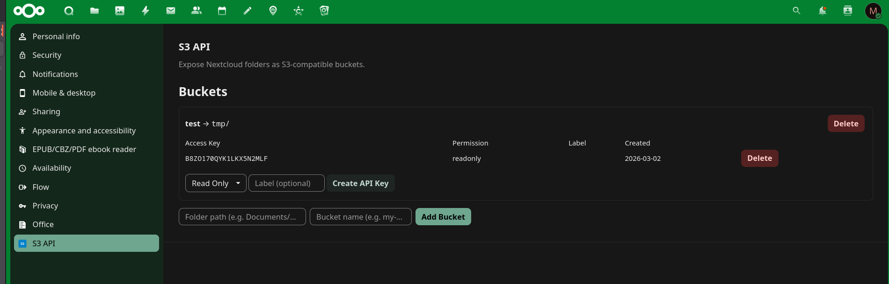

<div align="center">

# 🪣 S3 API for Nextcloud

**Point any S3 client at a folder you already have.**

*No object store · No duplication · Your files stay files*

[](https://nextcloud.com)
[](https://www.gnu.org/licenses/agpl-3.0)
[](https://www.php.net)

<br>



</div>

---

## What it does

Mark any Nextcloud folder as a bucket, create an API key, point `aws s3` at it. That's the whole
idea.

The files stay **ordinary Nextcloud files** — visible in the web UI, synced by the desktop client,
shareable, versioned, backed up along with everything else. There is no second copy in an object
store and no import step. A file a colleague drops into the shared folder is an object your script
can `GET` a second later.

```bash
aws s3 cp backup.tar.zst s3://my-bucket/ \
  --endpoint-url https://cloud.example.com/apps/s3_api/s3
```

---

## ✨ Why this one is different

Most "S3 for X" bridges implement the four calls a file sync needs and stop there. This one
implements the parts that let a real tool use it as a backend:

<table>
<tr><td width="50%" valign="top">

### 🔒 Conditional writes that actually hold
`If-Match` / `If-None-Match` with **serialised concurrent writers**, so exactly one of a set of
racing writes wins. That makes the store usable as a compare-and-swap primitive, not just a
key-value dump.

</td><td width="50%" valign="top">

### 🧩 Multipart, including compose
Create, upload, copy parts, complete, abort, list. `UploadPartCopy` gives you server-side compose —
stitching objects together without a round trip through the client.

</td></tr>
<tr><td valign="top">

### 📐 Correct ETags
Content MD5 for single-part, the compound `<md5-of-part-md5s>-<parts>` form for multipart.
Deliberately **not** Nextcloud's internal etag — see below for why that one is dangerous.

</td><td valign="top">

### 🌊 Real streaming
Bodies are decoded and written as a stream, never buffered in memory. `aws-chunked` payloads have
their **per-chunk signature chain verified**, which is what binds the uploaded bytes to the
credential.

</td></tr>
</table>

Plus ranged reads, conditional reads, delimited listings, presigned URLs and batch deletes.

> ⚠️ **Throughput.** Every request goes through PHP and Nextcloud's storage layer. This is a
> convenient way to talk S3 to data you already keep in Nextcloud — not a replacement for a real
> object store in front of a large workload.

---

## 🚀 Quick start

```bash
cp -r s3_api /var/www/nextcloud/apps/
sudo -u www-data php occ app:enable s3_api
```

Then in Nextcloud: **Settings → Personal → S3 API** → register a folder as a bucket → create an
API key. Note down both keys; the secret is shown once.

<details>
<summary><b>Requirements and update notes</b></summary>

<br>

* Nextcloud 33–36, PHP 8.2+ — Nextcloud 35 and 36 need 8.3, but enforce that themselves, so the
  app's own floor only has to suit the older end of the range. 36 is declared ahead of its
  release and tested against the daily master build
* **Nextcloud's cron must run** — abandoned multipart uploads are only reclaimed by a background
  job
* `app:enable` runs the migrations. `occ upgrade` is for core upgrades and will not touch an app.
  To update after bumping the version: `occ app:disable s3_api && occ app:enable s3_api`

</details>

---

## 🔧 Connecting a client

**Endpoint:** `https://<nextcloud-host>/apps/s3_api/s3`

Only **path-style** addressing works (`<endpoint>/<bucket>/<key>`) — a Nextcloud instance cannot
serve per-bucket subdomains. Most clients need to be told this explicitly.

> **Trailing slash:** some SDKs (notably `aws-sdk-rust`) append the bucket to the endpoint without
> a separator, turning `…/s3` into `…/s3my-bucket` and 404ing on every request. If your client
> does no path normalisation, configure `https://<host>/apps/s3_api/s3/`. The AWS CLI and boto3
> accept either form.

### AWS CLI

```ini
# ~/.aws/credentials
[nextcloud]
aws_access_key_id     = <access-key>
aws_secret_access_key = <secret-key>
```

```bash
aws s3 ls s3://my-bucket \
  --endpoint-url https://<nextcloud-host>/apps/s3_api/s3 \
  --region us-east-1
```

### boto3

```python
import boto3
from botocore.config import Config

s3 = boto3.client(
    "s3",
    endpoint_url="https://<nextcloud-host>/apps/s3_api/s3",
    aws_access_key_id="<access-key>",
    aws_secret_access_key="<secret-key>",
    region_name="us-east-1",
    config=Config(signature_version="s3v4", s3={"addressing_style": "path"}),
)

s3.upload_file("file.txt", "my-bucket", "file.txt")
```

---

## 🐚 Using it as a gits3 backend

[gits3](https://github.com/markuman/gits3srv) is a git server in a single file: clone and push
over HTTP, bare repositories in the bucket, no database. Ref updates are conditional writes on
`packed-refs` (`If-Match`), packs go up as plain PUTs. That exercises considerably more of the S3
API than a file sync does: compare-and-swap, content ETags, ranged reads, delimited listings.

**gits3's own S3 client and a real push / clone / gc cycle run against this app in the test
suite** (`tests/test_gits3.py`, `tests/test_gits3_e2e.py`).

<details>
<summary><b>Environment</b></summary>

<br>

gits3 configures itself from the environment, there is no config file:

```bash
GITS3_ENDPOINT=https://<nextcloud-host>/apps/s3_api/s3 \
GITS3_BUCKET=gittest \
GITS3_PREFIX=repos/ \
AWS_ACCESS_KEY_ID=<access-key> \
AWS_SECRET_ACCESS_KEY=<secret-key> \
GITS3_USERS="m:<password>:rw" \
python3 gits3.py
```

The API key needs `readwrite` — every push writes packs and rewrites `packed-refs`.

</details>

<details>
<summary><b>Verifying it yourself</b></summary>

<br>

```bash
tests/run.sh -k gits3
```

drives gits3's own S3 client against the endpoint and pushes, clones and garbage-collects a real
repository through a running gits3 instance. It looks for `../gits3srv/gits3.py` (override with
`GITS3=…`) and is skipped when it is missing.

A repository in the bucket is a plain bare repo — restore it without gits3:

```bash
aws s3 sync s3://gittest/repos/foo.git ./foo.git \
  --endpoint-url https://<nextcloud-host>/apps/s3_api/s3
git clone ./foo.git
```

</details>

**Caveats for this use case:** a push is one request carrying one pack, stored as one PUT — it is
bounded by `post_max_size`, `upload_max_filesize` and the web server's body limit (nginx
`client_max_body_size`). Raise all three plus `fastcgi_read_timeout` and keep `GITS3_MAX_BODY`
below them; gc writes a pack that knows no push limit, so repack large repositories locally before
the first push. And cron has to run, or abandoned uploads are never reclaimed.

**CAS is only as good as the ETag.** gits3 fences concurrent pushes by rewriting `packed-refs`
with `If-Match`. That holds because this app computes ETags from content — Nextcloud's own etag
has one-second resolution and could accept a lost update (see below).

**`503 SlowDown` under parallel writes.** Writers that race into a folder that does not exist yet
contend for Nextcloud's file locks while creating it; the losers get `503 SlowDown` before anything
is written, so a retry is safe and normally succeeds because the folder exists by then. gits3
retries transient S3 errors, so the usual race resolves on its own.

---

## 📋 Supported operations

| Operation                | Method | Notes                                                     |
|--------------------------|--------|-----------------------------------------------------------|
| ListBuckets              | GET    | reports only the bucket the key is scoped to              |
| HeadBucket               | HEAD   |                                                           |
| GetBucketLocation        | GET    | `?location`, always `us-east-1`                           |
| GetBucketVersioning      | GET    | `?versioning`, always unversioned                         |
| ListObjects (v1)         | GET    | `prefix`, `delimiter`, `marker`, `max-keys`               |
| ListObjects (v2)         | GET    | plus `start-after`, `continuation-token`                  |
| GetObject                | GET    | `Range`, `If-Match`, `If-None-Match`                      |
| HeadObject               | HEAD   |                                                           |
| PutObject                | PUT    | `If-Match`, `If-None-Match`, `aws-chunked` bodies         |
| CopyObject               | PUT    | `x-amz-copy-source`, same bucket only                     |
| DeleteObject             | DELETE |                                                           |
| DeleteObjects            | POST   | `?delete`                                                 |
| CreateMultipartUpload    | POST   | `?uploads`                                                |
| UploadPart               | PUT    | `?uploadId&partNumber`                                    |
| UploadPartCopy           | PUT    | plus `x-amz-copy-source-range`                            |
| CompleteMultipartUpload  | POST   | `?uploadId`                                               |
| AbortMultipartUpload     | DELETE | `?uploadId`                                               |
| ListParts                | GET    | `?uploadId`                                               |
| ListMultipartUploads     | GET    | `?uploads`                                                |

Any other subresource (`?acl`, `?tagging`, `?lifecycle`, …) answers `NotImplemented` rather than
being ignored — an ignored subresource would otherwise be handled as an operation on the object
itself.

---

## 🧠 Semantics worth knowing

<details open>
<summary><b>Why not Nextcloud's own etag</b></summary>

<br>

Nextcloud's etag is `md5(mtime + inode + dev + size)`. Because mtime has one-second resolution,
**two writes of equally sized but different content within the same second share an etag** — more
than enough for a compare-and-swap to accept a lost update.

This app therefore computes S3 ETags from content: plain MD5 for single-part uploads, the compound
`<md5-of-part-md5s>-<parts>` form for multipart. Objects written outside this API (web UI, WebDAV,
sync client) get an ETag on first read.

</details>

* **Conditional writes** return `412 PreconditionFailed`. `If-None-Match: *` is create-only,
  `If-Match: <etag>` replaces exactly that version. Concurrent conditional writes to one key are
  serialised, so exactly one of a set of racing creates or updates succeeds.
* **Streaming.** Uploads are not held in memory. `Content-Encoding: aws-chunked` with a trailing
  checksum — the default for current AWS SDKs — is decoded rather than stored verbatim. Where the
  client signs each chunk (`STREAMING-AWS4-HMAC-SHA256-PAYLOAD`) the signature chain is verified,
  which is what ties the uploaded bytes to the credential: with that payload type, SigV4 itself
  covers only the headers.
* **Multipart parts** live in a hidden `.s3-uploads/` folder inside the bucket while an upload is
  in flight, excluded from listings. Uploads never completed or aborted are reclaimed after a week
  by a background job.
* **Keys map to paths.** A key containing `/` creates folders, so `a/b` and `a` cannot both be
  objects.

---

## 🔐 Authentication

**AWS Signature V4**, either via the `Authorization` header or as a presigned URL
(`X-Amz-Signature` in the query string). Requests older than 15 minutes are rejected, as are
expired presigned URLs; `X-Amz-Expires` is capped at seven days, as on AWS. `host` and every
`x-amz-*` header the request carries must be signed.

Each API key is bound to **exactly one bucket** and is either `readonly` or `readwrite`.
`ListBuckets` reports only that bucket — not every bucket the owning account happens to have —
and any other bucket name answers `NoSuchBucket`, whether the account has such a bucket or not.
Keys stop working when their account is disabled and are removed when it is deleted. Wrong
secrets and unknown keys count towards Nextcloud's brute force protection.

> **Use HTTPS.** As on AWS, a signature only proves who made the request. Within its 15 minutes
> (or a presigned URL's lifetime) anyone who captured it can replay it, and the request and
> response bodies travel in the clear on plain HTTP.

---

## 🛠️ Development

<details>
<summary><b>Running the tests</b></summary>

<br>

```bash
tests/run.sh                         # Nextcloud 34, throwaway container
NC_VERSION=35 tests/run.sh -k multipart -x
NC_VERSION=master tests/run.sh       # next major, built from the daily tarball
KEEP=1 tests/run.sh                  # keep the container, reuse it next run
```

Needs `podman` (or `ENGINE=docker`), `curl` and `uv`. The script starts the official
`nextcloud:<version>-apache` image with SQLite, mounts `s3_api/` read-only, enables the app and
runs the pytest suite in `tests/` against `http://127.0.0.1:18080`. Buckets and keys are created by
the suite itself through the settings API.

The gits3 tests run [gits3](https://github.com/markuman/gits3srv)'s own S3 client and a real
push / clone / gc cycle through it. They look for `../gits3srv/gits3.py` (override with
`GITS3=…`) and are skipped when it is missing.

</details>

<details>
<summary><b>Publishing a release to the Nextcloud App Store</b></summary>

<br>

```bash
./build-release.sh --no-sign   # or without the flag once you have a certificate
```

GitHub's own release tarballs are *not* usable: they put the version into the top level folder
name, while the store requires that folder to be exactly the app id. The script builds a
conforming archive and verifies the layout.

**One-time setup:**

1. Generate a key and CSR — the CN **must** be the app id, `s3_api`:
   ```bash
   mkdir -p ~/.nextcloud/certificates && cd ~/.nextcloud/certificates
   openssl req -nodes -newkey rsa:4096 -keyout s3_api.key -out s3_api.csr -subj "/CN=s3_api"
   ```
2. Open a PR with `s3_api.csr` against
   [nextcloud/app-certificate-requests](https://github.com/nextcloud/app-certificate-requests).
   They sign it and post `s3_api.crt` back — save it next to the key.
3. Register the app id at [apps.nextcloud.com/developer/apps/new](https://apps.nextcloud.com/developer/apps/new)
   with the certificate and this signature:
   ```bash
   echo -n "s3_api" | openssl dgst -sha512 -sign ~/.nextcloud/certificates/s3_api.key | openssl base64
   ```

**Per release:** bump `<version>` in `s3_api/appinfo/info.xml`, add a matching `## X.Y.Z` section
to `CHANGELOG.md` (the script refuses to build if they disagree — a mismatch makes the store
import an empty changelog), tag, attach the tarball to a GitHub release, then submit the URL plus
the printed signature at
[developer/apps/releases/new](https://apps.nextcloud.com/developer/apps/releases/new).

> Keep `s3_api.key` private. Losing it means revoking the certificate, and re-registering deletes
> every existing release.

</details>

---

<div align="center">

**AGPL-3.0-or-later**

*Designed by a human, generated by robots. Blame the human.*
</div>
